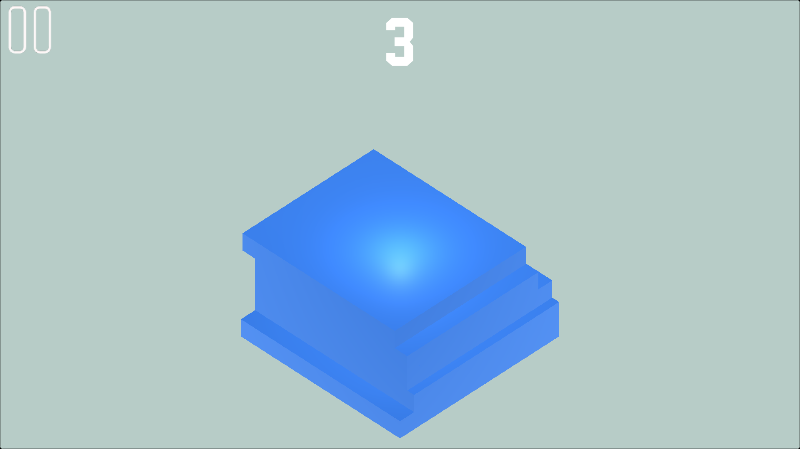

# 🎮 StackUp

**A 3D Arcade Stacking Game | Built with Unity & C#**

---

### 📌 About the Game

StackUp is a casual 3D arcade game where players stack moving blocks on top of each other. Test your timing and precision to build the tallest tower and achieve a high score.

### ✨ Features

- 3D stacking gameplay
- Precision-based placement mechanics
- Perfect placement bonus system
- Score tracking
- High score saving using PlayerPrefs
- WebGL and mobile development

### 🏆 Scoring System

| Action | Points |
|---|---:|
| Normal Placement | +1 |
| Perfect Placement | +3 |

### 🛠️ Technologies Used

- **Engine:** Unity 6
- **Language:** C#
- **Data Storage:** PlayerPrefs

---

### 📸 Screenshots

---

### 👨‍💻 Developer

**Aneeq Mughal**

BS Computer Science Student  
Aspiring Unity Gameplay Programmer

[GitHub Profile](https://github.com/aneeqmughal404)

---

*Developed as a game development project.*
